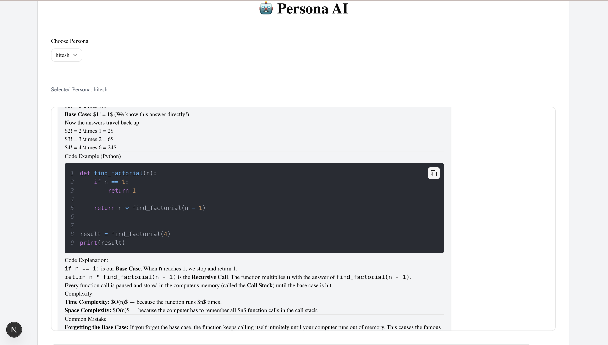
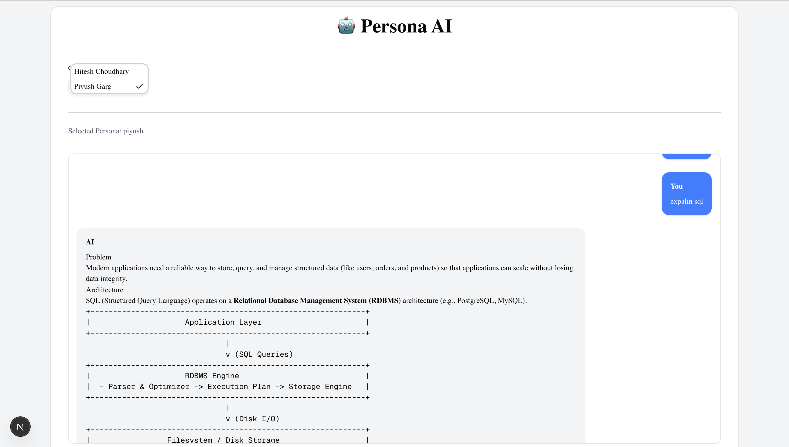

# 🤖 Persona AI

An AI-powered multi-persona chatbot built with **Next.js, TypeScript, React, and Google Gemini**. Interact with different AI personas and experience real-time streaming conversations through a clean and responsive chat interface.

## ✨ Features

- **Multiple AI Personas:** Switch between different AI personalities, including Hitesh and Piyush.
- **Real-Time Streaming:** Receive AI responses progressively instead of waiting for the complete response.
- **Persona-Based Prompting:** Dynamically generate system instructions based on the selected persona.
- **Retry Mechanism:** Automatically retries eligible temporary API failures.
- **Conversation Interface:** Interactive chat interface with user and AI messages.
- **Persistent Persona Selection:** Remembers the selected persona using browser local storage.
- **Error Handling:** Handles API failures and empty AI responses gracefully.

## 🛠️ Tech Stack

| Category | Technologies |
|---|---|
| Frontend | Next.js, React, TypeScript |
| Styling | Tailwind CSS, shadcn/ui |
| AI Integration | Google Gemini API |
| Backend | Next.js API Routes |
| State Management | React Hooks |
| Development Tools | Git, GitHub, npm |

## 📸 Screenshots

<!-- Add your application screenshots here -->

### Chat Interface



### Persona Selection



## 🏗️ Project Architecture

```text
persona_ai/
│
├── app/
│   ├── api/chat/
│   │   └── route.ts
│   ├── page.tsx
│   └── globals.css
│
├── components/
│   ├── PersonaSelector.tsx
│   ├── ChatBox.tsx
│   └── ChatInput.tsx
│
├── hooks/
│   └── useChat.ts
│
├── lib/
│   ├── ai.ts
│   ├── promptBuilder.ts
│   └── types.ts
│
├── public/
└── README.md
```

## ⚙️ Getting Started

Follow these instructions to run the project locally.

### 1. Clone the repository

```bash
git clone https://github.com/krishnaydv3214-coder/persona-ai.git
```

### 2. Navigate to the project directory

```bash
cd persona-ai
```

### 3. Install dependencies

```bash
npm install
```

### 4. Configure environment variables

Create a `.env.local` file in the root directory.

Add your Gemini API key:

```env
GEMINI_API_KEY=your_gemini_api_key
```

Get an API key from [Google AI Studio](https://aistudio.google.com/apikey).

### 5. Run the development server

```bash
npm run dev
```

Open [http://localhost:3000](http://localhost:3000) in your browser.

## 🔐 Environment Variables

| Variable | Description |
|---|---|
| `GEMINI_API_KEY` | API key used to access Google Gemini |

**Important:** Never commit your `.env.local` file or expose your API key publicly.

## 🚀 Future Improvements

- Add user authentication.
- Store conversation history in a database.
- Allow users to create custom AI personas.
- Add support for multiple conversations.
- Deploy the application with a production-ready configuration.

## 👨‍💻 Author

**Krishna Kumar**

B.Tech Computer Science and Engineering

[GitHub](https://github.com/krishnaydv3214-coder)

---

⭐ If you find this project interesting, consider giving it a star!